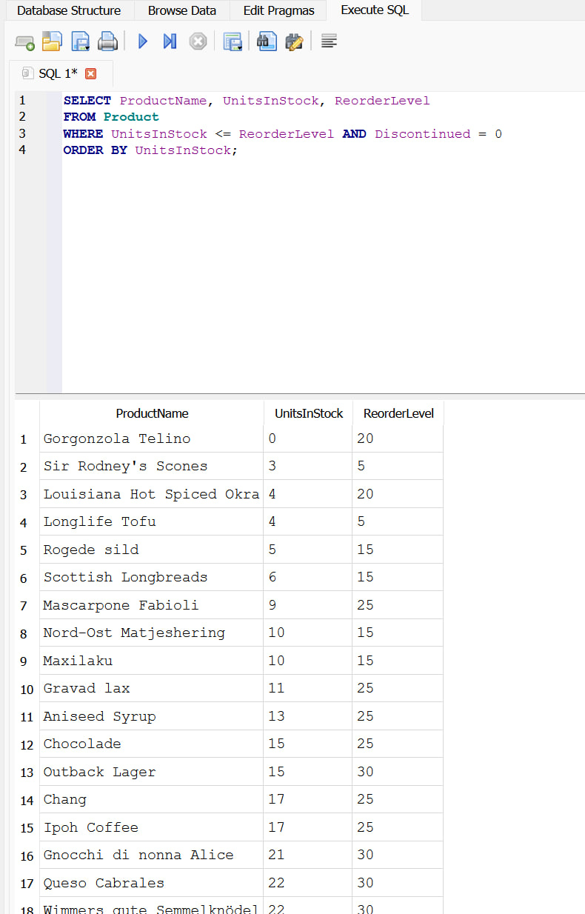
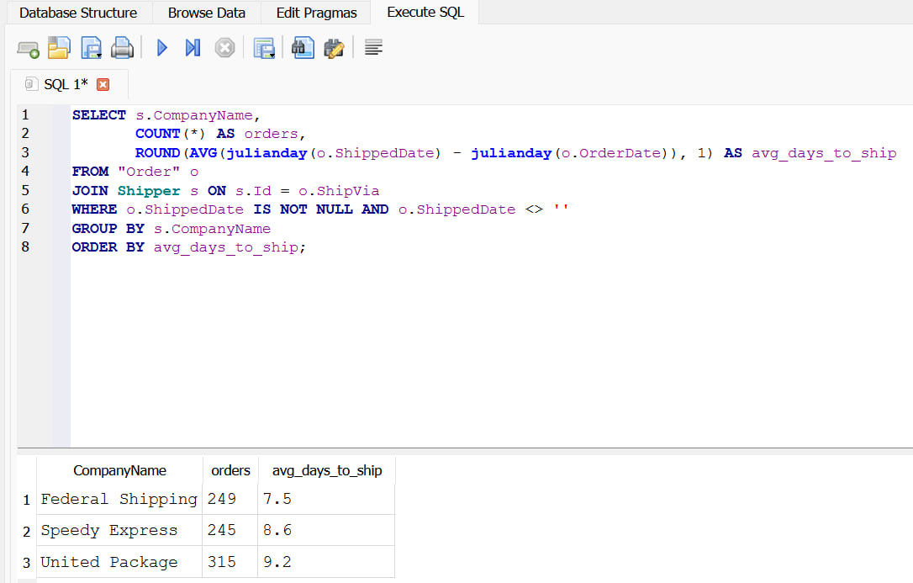
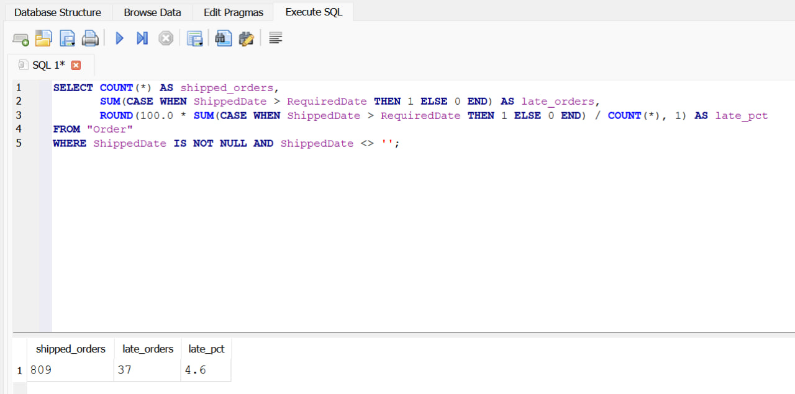
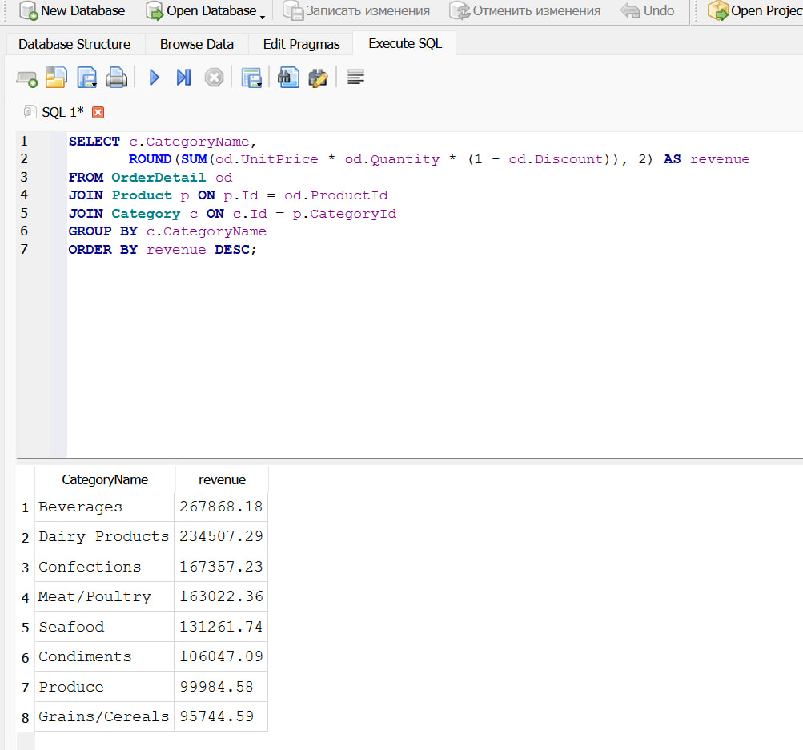
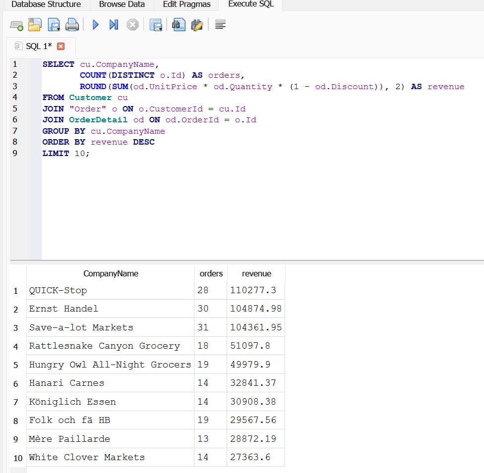

# SQL Practice: Inventory and Shipping Analysis

Practice project on the Northwind sample database (SQLite). I used it to
practise SELECT, JOIN, GROUP BY and date functions on questions similar to
warehouse operations.

Data: `Northwind_small.sqlite` (sample data, no real company data).
Tool: DB Browser for SQLite. All queries are in `queries.sql`.

## 1. Which products are at or below their reorder level?

## 2. How many days does each shipping company take to ship an order?

## 3. What share of orders ships after the required date?

## 4. Which product categories bring the most revenue?

## 5. Who are the top 10 customers by revenue?

## Findings
- At least 18 products are at or below their reorder level; Gorgonzola Telino is out of stock (0 units, reorder level 20) and should be reordered first.
- Federal Shipping ships orders fastest (7.5 days on average), United Package slowest (9.2 days) while handling the most orders (315). This is time from order to shipment, not delivery time.
- 37 of 809 shipped orders (4.6%) went out after the required date.
- Beverages and Dairy Products bring about 40% of total revenue.
- The top 3 customers account for roughly a quarter of total revenue.
